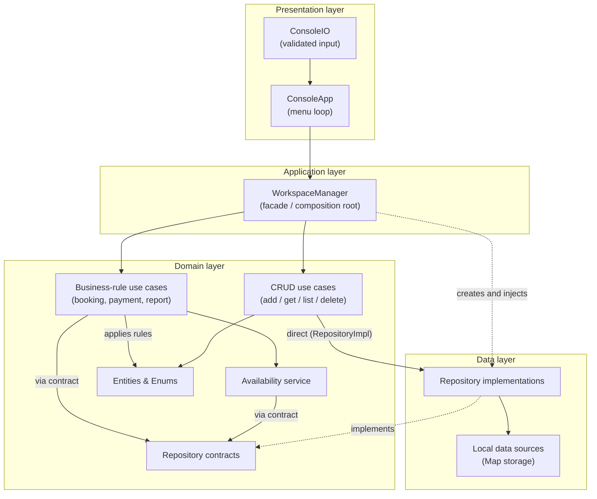
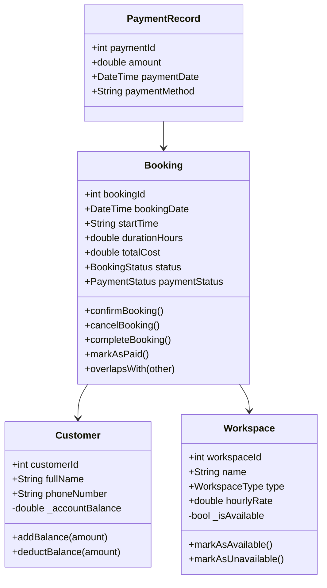
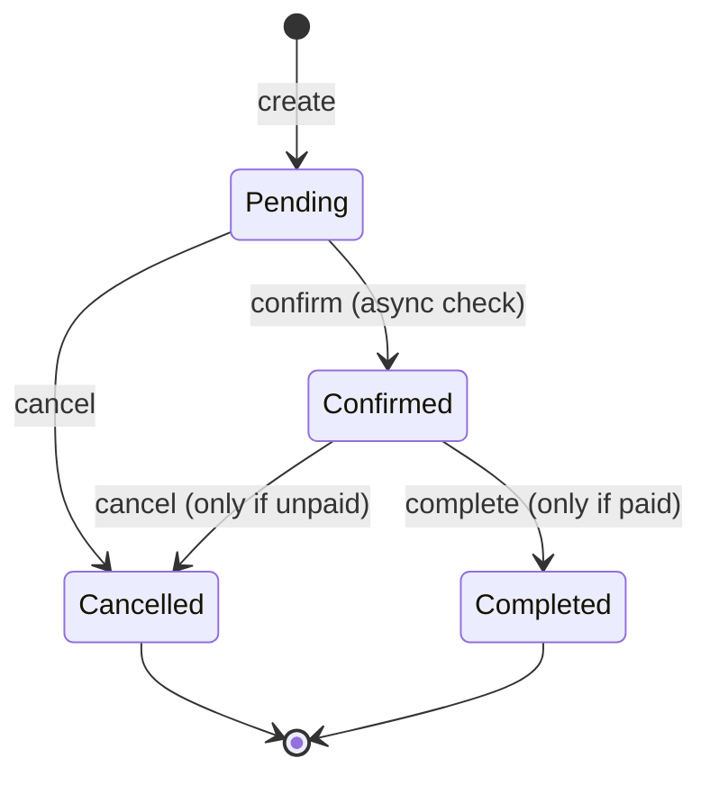

<div align="center">

# 🏢 Smart Co-Working Space Management System

**A console application written in Dart that manages customers, workspaces, bookings, payments and reports, built with Clean Architecture.**


</div>

---

## 📑 Table of Contents

1. [Overview](#-overview)
2. [Features](#-features)
3. [Architecture](#-architecture)
4. [Why Clean Architecture?](#-why-clean-architecture)
5. [Project Structure](#-project-structure)
6. [Domain Model](#-domain-model)
7. [Business Rules](#-business-rules)
8. [Key Flows](#-key-flows)
9. [Error Handling Strategy](#-error-handling-strategy)
10. [Getting Started](#-getting-started)
11. [Menu Reference](#-menu-reference)
12. [Sample Session](#-sample-session)
13. [Tested Scenarios](#-tested-scenarios)
14. [Requirements Coverage](#-requirements-coverage)
15. [Design Decisions & Trade-offs](#-design-decisions--trade-offs)
16. [Future Improvements](#-future-improvements)

---

## 📌 Overview

The system simulates the back-office of a shared workspace. Customers can book **desks**, **private offices** and **meeting rooms** for a specific date, start time and duration. The system calculates the cost, prevents double-booking, processes payments from a prepaid account balance, keeps workspace availability consistent, and produces management reports.

The project was designed as more than a "single big file" exercise. Every responsibility lives in its own layer, so each class can be explained, tested and changed in isolation. That is what makes the code easy to extend, for example by adding a new report, a new workspace type or a database, without touching unrelated code.

---

## ✨ Features

| Area | Capabilities |
|------|--------------|
| **Customers** | Register (ID, name, phone, balance), search by ID, list all, top-up balance. Duplicate IDs and duplicate phone numbers are rejected. |
| **Workspaces** | Add, remove (only if no active bookings), list all, search by ID, filter by type, show only available. |
| **Bookings** | Create, search, list, list per customer, confirm, cancel, complete. Automatic cost calculation and overlap prevention. |
| **Payments** | Pay confirmed bookings from account balance, with duplicate-payment protection and a saved payment record. |
| **Reports** | Customers, workspaces by type, booking totals by status, revenue, most-booked workspace, unpaid bookings. Empty data is handled gracefully. |
| **Async** | Booking confirmation performs a simulated 2-second availability check with `Future`, `async` and `await`. |
| **Robustness** | Every input is validated and retried. Custom exceptions plus `try/catch` mean the program never crashes on bad input. |

---

## 🏗 Architecture

The project follows **Clean Architecture**. Source-code dependencies always point **inward**: outer layers know about inner layers, never the other way around.



### Layer responsibilities

| Layer | Responsibility | Knows about |
|-------|----------------|-------------|
| **Presentation** | Talks to the user: prints menus, reads and validates input, formats output. Contains **no business logic**. | Application |
| **Application** | `WorkspaceManager` is the single entry point to the system. It wires repositories to use cases (a manual dependency-injection root) and exposes one clean method per feature. | Domain, Data |
| **Domain** | The heart of the system: entities with self-validation, enums, repository contracts, use cases (one class per operation) and domain services. Business-rule use cases depend only on the contracts. Simple CRUD use cases use the `RepositoryImpl` classes directly (see *Repository access strategy*). | Entities, contracts, and `RepositoryImpl` (CRUD use cases only) |
| **Data** | Implements the repository contracts on top of in-memory `Map` storage. | Domain |
| **Core** | Cross-cutting pieces such as the custom exception hierarchy. | Nothing |

---

## 🎯 Why Clean Architecture?

For a project of this size a single file would have worked. Layering was chosen deliberately, for these reasons:

1. **Separation of concerns.** Rules such as "a paid booking cannot be cancelled" live in the domain, not mixed with `print` and `stdin` calls. The UI can change completely without touching them.
2. **Replaceable storage (Repository pattern).** Business-rule use cases (booking, payment, report) and the availability service depend on abstract repositories such as `BookingRepository`. Today the implementation uses a `Map`; swapping it for SQLite, JSON files or an API means writing one new class for them. Simple CRUD use cases are intentionally coupled to the implementation classes (see *Repository access strategy*).
3. **Single Responsibility.** Each use case does exactly one thing (`CancelBooking`, `RecordPayment`, ...). A bug in payments is found in one small file, and a new feature is a new file.
4. **Testability.** Entities are plain Dart, and business-rule use cases depend only on contracts, so they can be unit-tested with fake repositories, without a terminal and without real storage.
5. **Explainability.** Each question has an obvious home: *"Where is the overlap check?"* is `Booking.overlapsWith` and `CreateBooking`. *"Where does money move?"* is `RecordPayment`. This matters for a project discussion where you must explain and modify code on request.
6. **Scalability.** The same domain and application layers could later power a Flutter app or a REST API. Only the presentation layer would be replaced.

---

## 📂 Project Structure

```
smart_coworking_system/
├── bin/
│   └── smart_coworking_system.dart        # Entry point: runs ConsoleApp
├── lib/
│   ├── core/
│   │   └── errors/
│   │       └── app_exceptions.dart        # AppException, ValidationException, NotFoundException
│   ├── domain/
│   │   ├── entities/                      # Customer, Workspace, Booking, PaymentRecord
│   │   ├── enums/                         # WorkspaceType, BookingStatus, PaymentStatus
│   │   ├── repositories/                  # Abstract contracts (interfaces)
│   │   ├── services/
│   │   │   └── workspace_availability_service.dart
│   │   └── use_cases/
│   │       ├── customer/                  # add, get, list, add balance, delete
│   │       ├── workspace/                 # add, delete, get, list, by type, available
│   │       ├── booking/                   # create, confirm (async), cancel, complete, queries
│   │       ├── payment/                   # record payment, queries
│   │       └── report/                    # generate_report
│   ├── data/
│   │   ├── data_sources/local/            # In-memory Map storage
│   │   └── repositories/                  # Implementations of the domain contracts
│   ├── application/
│   │   └── workspace_manager.dart         # Facade + dependency wiring
│   └── presentation/
│       ├── console_app.dart               # Menu loop and output formatting
│       └── console_io.dart                # Safe, retrying input helpers
└── pubspec.yaml
```

---

## 🗄 Repository access strategy

The use cases are split into two groups, on purpose:

| Group | Use cases | Depends on |
|-------|-----------|------------|
| **CRUD** | `AddCustomer`, `GetCustomerById`, `GetAllCustomers`, `DeleteCustomer`, `AddWorkspace`, `GetWorkspaceById`, `GetAllWorkspaces`, `GetWorkspacesByType`, `GetAvailableWorkspaces`, `GetAllBookings`, `GetBookingById`, `GetBookingsByCustomer`, `GetAllPayments`, `GetPaymentById`, `GetPaymentByBookingId` | `*RepositoryImpl` (data layer), directly |
| **Business rules** | `CreateBooking`, `ConfirmBooking`, `CancelBooking`, `CompleteBooking`, `RecordPayment`, `AddCustomerBalance`, `DeleteWorkspace`, `GenerateReport`, `WorkspaceAvailabilityService` | Repository **contracts** (abstract classes in `domain/repositories`) |

`WorkspaceManager` is the only place that creates the `RepositoryImpl` objects and injects them into both groups.

**Why:** plain CRUD use cases only read or save data, so an extra abstraction adds little for them. The use cases that coordinate several repositories and enforce rules (overlaps, payments, availability) are the ones worth protecting behind contracts.

**Trade-off:** the CRUD group is tied to the in-memory implementation. Changing the storage later means editing those use cases' types as well as the manager, while the business-rule group would not need any change.

---

## 🧩 Domain Model



**Encapsulation.** `accountBalance` and `isAvailable` are private fields exposed through getters. The only way to change them is through validated methods (`addBalance`, `deductBalance`, `markAsAvailable`, ...). It is impossible to set a negative balance from outside the class.

**Self-validating entities.** Constructors reject invalid state (empty names, non-positive rates or durations, negative balances), so an invalid object can never exist in memory.

**Rich entities.** `Booking` owns its own state transitions and time logic (`startDateTime`, `endDateTime`, `overlapsWith`, `isActive`), so the rules are defined once and reused everywhere.

---

## 📜 Business Rules

### Booking lifecycle



Any transition not shown above is rejected with a clear message (for example, confirming a cancelled booking).

### Rules enforced

| # | Rule |
|---|------|
| 1 | Customer and workspace must exist before a booking is created. |
| 2 | Duration must be greater than zero (and at most 24 hours). Start time must be a valid `HH:mm`. |
| 3 | **No overlaps:** two active (pending or confirmed) bookings for the same workspace cannot overlap in time. Back-to-back bookings (10:00–11:00 then 11:00–12:00) are allowed. |
| 4 | `totalCost = hourlyRate × durationHours`, calculated once when the booking is created. |
| 5 | **Availability:** a workspace is *unavailable* while it has at least one active booking. It is recalculated after create, confirm, cancel and complete from the **remaining** bookings. |
| 6 | A workspace with active bookings **cannot be removed**. |
| 7 | **Payment** requires: booking exists, booking is *Confirmed*, not already paid, and the customer has enough balance. |
| 8 | A failed payment **never** changes the balance (see *Payment flow*). |
| 9 | A booking must be **paid before it can be completed**. |
| 10 | A **paid** booking cannot be cancelled (the system has no refund feature, and allowing it would corrupt revenue figures). |
| 11 | Customer IDs, workspace IDs and phone numbers are unique. |

---

## 🔄 Key Flows

### Payment flow (all-or-nothing)

`RecordPayment` is deliberately written in two phases so the data can never end up half-updated:

```
Phase 1 - VALIDATE (nothing is modified)
  ├─ payment ID unique?
  ├─ booking exists?
  ├─ booking is Confirmed?
  ├─ not already paid?
  ├─ payment method not empty?
  ├─ customer exists?
  └─ balance >= total cost?
            │ any check fails → throw exception, state untouched
            ▼
Phase 2 - APPLY (only reached when everything is valid)
  ├─ deduct balance from customer
  ├─ mark booking as paid
  └─ save the PaymentRecord
```

Because every check runs before the first change, "if payment fails, the balance must remain unchanged" holds by construction, with no rollback logic needed.

### Asynchronous confirmation

```dart
Future<void> execute(int bookingId) async {
  await Future.delayed(const Duration(seconds: 2));   // simulated availability check
  // ...re-validate: booking pending? customer/workspace still exist?
  // ...no overlap with another CONFIRMED booking?
  booking.confirmBooking();                            // only if every check passed
}
```

The UI prints `Checking workspace availability...` before awaiting, then prints the result. The booking is confirmed **only** if all conditions are satisfied.

### Availability consistency

`WorkspaceAvailabilityService.refresh(workspaceId)` is the single place that decides `isAvailable`. Use cases call it after every operation that can change a booking's status. This guarantees booking data and availability data never drift apart.

---

## 🛡 Error Handling Strategy

```
AppException (implements Exception)
 ├── ValidationException    # bad data or rule violation
 └── NotFoundException      # entity does not exist
```

Defence in depth, with three levels:

1. **Input level (`ConsoleIO`).** Empty strings, non-numbers, negatives and impossible dates (such as `2026-02-31`) are rejected immediately and the user is asked again.
2. **Domain level.** Entities and use cases throw typed exceptions with human-readable messages when a business rule is broken.
3. **Application loop (`ConsoleApp`).** One `try/catch` per menu action catches `AppException`, `FormatException` and a final generic safety net, prints a friendly message and returns to the menu. If stdin is closed (Ctrl+D), the program exits cleanly instead of looping forever.

---

## 🚀 Getting Started

**Requirements:** Dart SDK 3.x

```bash
# 1. Install dependencies
dart pub get

# 2. Run the application
dart run bin/smart_coworking_system.dart
```

Booking dates use `yyyy-MM-dd` (press **Enter** for today) and times use 24-hour `HH:mm`.

---

## 🧭 Menu Reference

| # | Action | # | Action |
|---|--------|---|--------|
| 1 | Register Customer | 11 | Cancel Booking |
| 2 | Add Workspace | 12 | Confirm Booking *(async)* |
| 3 | Remove Workspace | 13 | Complete Booking |
| 4 | Display Workspaces | 14 | Process Payment |
| 5 | Search Workspace | 15 | Display Reports |
| 6 | Display Workspaces by Type | 16 | Search Customer ⭐ |
| 7 | Add Customer Balance | 17 | Display All Customers ⭐ |
| 8 | Create Booking | 18 | Display Available Workspaces ⭐ |
| 9 | Search Booking | 19 | Display Customer Bookings ⭐ |
| 10 | Display All Bookings | 20 | Display Unpaid Bookings ⭐ |
| | | 0 | Exit |

⭐ = additional options beyond the assignment's example menu.

---

## 💻 Sample Session

```text
Enter your choice: 8
Customer ID: 1
Workspace ID: 5
Date (yyyy-MM-dd, Enter = today):
Start time (HH:mm): 10:00
Duration in hours: 3
  Booking #1 created (Pending). Total cost: 60.00

Enter your choice: 8                        <- same workspace, overlapping time
  Error: Workspace is already booked during this time

Enter your choice: 12
Booking ID: 1
  Checking workspace availability...        <- 2-second async delay
  Workspace is available. Booking #1 confirmed.

Enter your choice: 14
Booking ID: 1
  Error: Insufficient account balance to pay for this booking.

Enter your choice: 7                        <- top up, then pay again
  Balance updated. New balance: 60.00
Enter your choice: 14
  Payment #1 successful. Paid 60.00. Remaining balance: 0.00

Enter your choice: 14                       <- duplicate payment
  Error: This booking has already been paid.
```

---

## ✅ Tested Scenarios

The application was run end-to-end with scripted input covering both success and failure paths:

| Scenario | Expected result | ✔ |
|----------|-----------------|---|
| Register customer with duplicate ID / duplicate phone | Rejected | ✔ |
| Empty name, negative balance, negative rate | Rejected, input re-requested | ✔ |
| Book a non-existent customer or workspace | Rejected | ✔ |
| Overlapping booking on the same workspace | Rejected | ✔ |
| Invalid time (`25:00`) and negative duration | Rejected | ✔ |
| Pay a *pending* booking | Rejected (must be confirmed) | ✔ |
| Pay with insufficient balance | Rejected, balance unchanged | ✔ |
| Pay twice | Second payment rejected | ✔ |
| Remove workspace with an active booking | Rejected | ✔ |
| Cancel a paid / completed booking | Rejected | ✔ |
| Cancel a booking | Workspace availability recalculated | ✔ |
| Complete an unpaid or non-confirmed booking | Rejected | ✔ |
| Invalid menu option / text instead of a number | Message shown, no crash | ✔ |
| Reports with no data | "No bookings" handled gracefully | ✔ |
| Report after a booked workspace was removed | Still shows the correct most-booked workspace | ✔ |

---

## 📋 Requirements Coverage

| Assignment requirement | Where it is implemented |
|------------------------|-------------------------|
| Classes: Customer, Workspace, Booking | `lib/domain/entities/` |
| WorkspaceManager with List / Map collections | `lib/application/workspace_manager.dart` (facade) over `Map`-based data sources and `List` queries |
| Customer management | `use_cases/customer/` |
| Workspace management | `use_cases/workspace/` |
| Booking management and status rules | `use_cases/booking/`, `Booking` entity |
| Overlap prevention | `Booking.overlapsWith`, `CreateBooking`, `ConfirmBooking` |
| Availability updates on cancel | `WorkspaceAvailabilityService` |
| Payment processing and records | `use_cases/payment/record_payment.dart`, `PaymentRecord` |
| Reports | `use_cases/report/generate_report.dart` |
| Async with Future / async / await | `use_cases/booking/confirm_booking.dart` |
| Menu-driven interface | `presentation/console_app.dart` |
| Validation and custom exceptions | `core/errors/`, entity constructors, `ConsoleIO` |
| OOP: encapsulation, constructors, relationships | Private fields with getters, validating constructors, `Booking → Customer / Workspace` |

---

## 🧠 Design Decisions & Trade-offs

| Decision | Reasoning | Trade-off |
|----------|-----------|-----------|
| **Use case per operation** | Tiny, focused, easy to explain and modify. | More files than a monolithic manager. |
| **`WorkspaceManager` as a facade** | Satisfies the "manager" requirement while keeping the UI ignorant of use cases and repositories. | One more layer to read. |
| **CRUD use cases use `RepositoryImpl` directly** | Less indirection for simple data access; business-rule use cases still use the contracts. | CRUD use cases are coupled to the data layer. |
| **In-memory storage** | Simple and sufficient for the assignment. The repository abstraction makes persistence a drop-in change. | Data is lost when the program exits. |
| **Auto-generated booking and payment IDs** | Removes user-typed duplicates for system-owned records. Customer and workspace IDs stay user-supplied, as the assignment requires validating them. | None significant. |
| **Validate-then-apply payments** | Guarantees atomicity without needing rollback code. | Checks are written explicitly in order. |
| **Pending *and* confirmed bookings block a workspace** | Prevents two customers holding the same slot while one is still unconfirmed. | A workspace shows *Unavailable* as soon as a pending booking exists. |
| **No cancellation of paid bookings** | Without a refund feature, cancelling would leave revenue and balances inconsistent. | A refund flow would be needed to lift this restriction. |
| **Booking must be paid before completion** | Prevents completed-but-unpayable bookings, since payment is only allowed for confirmed ones. | Stricter than the minimum in the assignment. |

---

## 🔮 Future Improvements

- **Refund support**, allowing cancellation of paid bookings with a balance credit and a refund record.
- **Persistence** with a JSON file or SQLite, by adding new repository implementations only.
- **Unit tests** for entities and use cases (entities, and business-rule use cases with fake repositories).
- **Pricing rules** such as peak hours, discounts and membership tiers as new domain services.
- **Time-slot suggestions** that recommend the next free slot when a booking overlaps.
- **Flutter or REST front-end** reusing the domain and application layers unchanged.

---

<div align="center">

Dart Programming - Assignment 2

**Developed by Eng. Tariq Zeyad**

</div>
